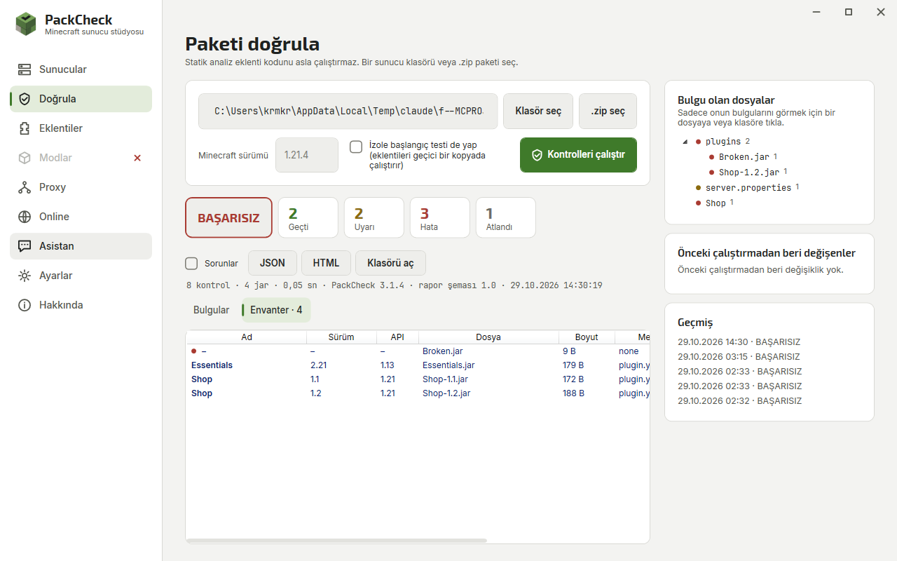
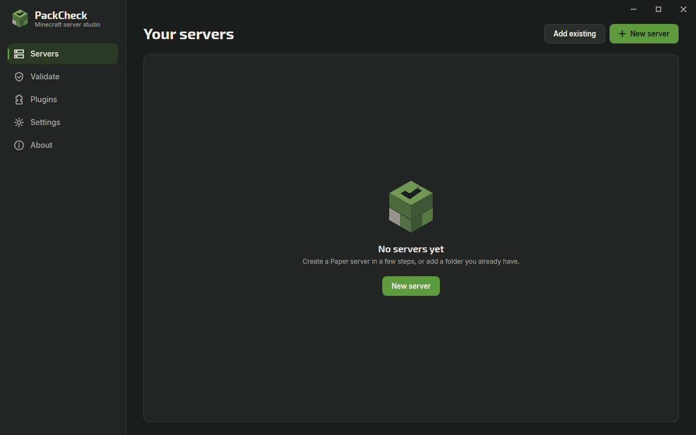

<p align="center">
  
</p>

<p align="center">
  <b>Create, run and validate Minecraft Java servers, and catch broken plugin packs before they go live.</b>
</p>

<p align="center">
  <a href="https://github.com/X1NPAR1/PackCheck/releases/latest">Download</a> ·
  <a href="#cli">CLI</a> ·
  <a href="docs/security.md">Security model</a> ·
  <a href="CHANGELOG.md">Changelog</a>
</p>

---

PackCheck is a Windows desktop app (WPF, .NET 10) for people who run Paper servers. It does two jobs:

- **Server studio.** Create a Paper, Purpur, Vanilla, Fabric, Forge or NeoForge server from official sources, start and stop it, watch the live console, edit `server.properties`, manage plugins and take backups.
- **Pack validation.** Before you add or update plugins, PackCheck reads every JAR and config file and tells you what will break: missing dependencies, duplicate plugins, corrupt downloads, plugins built for a newer Minecraft version, invalid settings. Each finding comes with evidence and a suggested fix.

Static checks never execute plugin code. A real startup test is available, but you have to turn it on yourself, and it runs on a throw-away copy of the pack.

## Screenshots

| Validation | Servers |
|---|---|
|  |  |

| Settings | About |
|---|---|
|  |  |

## Features

**Servers**
- 16 platforms: Paper, Purpur, Folia, Leaf, Leaves, Spigot and CraftBukkit (compiled with BuildTools), Vanilla, Fabric, Quilt, Forge, NeoForge, SpongeVanilla, Mohist, Youer and Arclight. Version lists come from each project's own API, so only versions with a real download appear.
- Downloads are hash-verified wherever the source publishes a hash; Forge, NeoForge, Quilt and BuildTools run automatically.
- The right Java (8, 17, 21 or 25) is installed automatically from Eclipse Temurin before a server starts.
- Explicit EULA consent: nothing is accepted on your behalf.
- Live dashboard: ring gauges for TPS, CPU, RAM and ping with five health levels, players, uptime, disk and world size.
- Console with level filters and counters, search, timestamps, copy/save, command history and Tab completion, quick actions, player list and crash detection.
- Files tab: upload by drag and drop, multi-select, copy/cut/paste, zip/unzip, delete to the Recycle Bin, and a code editor with line numbers, syntax highlighting and a syntax check before saving.
- `server.properties` editor with every setting explained, grouped, typed and resettable.
- Every server process tree runs in a Windows Job Object; nothing keeps running after a crash or a forced stop.
- Zip backups with retention and restore.

**Plugins, mods and modpacks**
- Browse Modrinth, Hangar and CurseForge page by page, sorted by downloads or updates, without having to search first.
- Items that do not match the selected server's Minecraft version or loader cannot be installed, and the reason is shown.
- Modrinth `.mrpack` modpacks are installed file by file with SHA-512 checks; CurseForge server packs are extracted safely.
- The sidebar only enables Plugins or Mods when the selected server can use them.

**Online**
- Open a server to the internet: a firewall rule (after you approve the Windows prompt) and UPnP forwarding on the router.
- Copy the public address, get A and SRV records for your own domain, optionally keep a DuckDNS name up to date.
- Carrier-grade NAT is detected and explained. Closing removes the forwarding and the firewall rule again.

**Validation**
- Pack structure, `server.properties` values, corrupt or unreadable JARs, oversized files.
- Reads `plugin.yml` and `paper-plugin.yml` metadata; compatibility is never guessed from file names.
- Required and optional dependencies, duplicates, `api-version` vs. server version, Java vs. Minecraft version.
- Results are `PASS`, `WARN`, `FAIL`, `SKIP` or `ERROR`. "Failed" and "could not run" are never the same thing.
- Pre-flight checks before plugin changes, run history with diff, JSON (with a [schema](docs/schema/report.schema.json)) and self-contained HTML reports.

**App**
- EXE and MSI installers, per-user, no admin rights needed.
- English, Turkish, German, French and Russian, switchable instantly.
- Dark and light themes (or follow Windows); Full, Reduced or Off animations.
- Runs in the system tray, optionally starts with Windows.
- No telemetry.

## Updates

On every start, PackCheck asks GitHub for the latest release.

- If a newer version exists, a dialog shows its release notes. You can update now or postpone.
- You can postpone on the day the update is first announced and on the next day. **On the first launch of the third day, PackCheck installs the update by itself.**
- With **Settings → Updates → Install new releases automatically** turned on, new releases are installed at startup without asking.
- Packages are downloaded only from the repository's release assets and are rejected if their SHA-256 does not match the published `.sha256` file.
- Offline? The check is skipped silently and the app starts normally.

## Install

Download **`PackCheck-Setup-<version>.exe`** (or the `.msi`) from the [latest release](https://github.com/X1NPAR1/PackCheck/releases/latest) and run it.
It installs for your Windows user only, so no administrator rights are needed, and later updates install silently.

The app is self-contained, so .NET does not need to be installed. Windows 10 or 11 (x64) is required. The binaries are not code-signed yet, so SmartScreen may warn on the first launch.

## CLI

`packcheck` is the same validation engine without the UI. It is useful in CI.

```text
packcheck validate <folder|pack.zip> [--format text|json|html] [--output file]
                   [--mc-version 1.20.4] [--java 21] [--fail-on-warnings] [--timeout 300] [--verbose]
packcheck doctor
packcheck version
```

| Exit code | Meaning |
|---|---|
| 0 | Pass, or pass with warnings |
| 1 | Validation failed (or warnings with `--fail-on-warnings`) |
| 2 | Incomplete: a check could not run |
| 64 | Usage error |
| 70 | Internal error |

Example output:

```text
PackCheck 1.0.0 - demo-pack
  [FAIL ] PC040 Missing dependency: 'EconomyShop' requires 'ProtocolLib', which is not installed. The plugin will not enable.
           plugin.yml: depend: [Vault, ProtocolLib]
           fix: Install 'ProtocolLib' or remove 'EconomyShop'.
  [FAIL ] PC030 Duplicate plugin: 'Homes' is installed 2 times; the server loads only one of them.
Result: FAIL  (pass 2, warn 1, fail 5, skip 1, error 0)
```

### GitHub Actions

```yaml
- name: Validate server pack
  shell: pwsh
  run: |
    Invoke-WebRequest https://github.com/X1NPAR1/PackCheck/releases/latest/download/packcheck-cli-win-x64.zip -OutFile packcheck.zip
    Expand-Archive packcheck.zip -DestinationPath packcheck
    ./packcheck/packcheck.exe validate ./server --mc-version 1.20.4 --format html --output packcheck-report.html
```

## Checks

| ID | Check |
|---|---|
| PC000 | Target exists; archive is safe to extract (path traversal, zip bombs) |
| PC001 / PC002 | Pack structure, server JAR present |
| PC010 / PC011 | `server.properties` values, offline-mode warning |
| PC020 / PC021 / PC022 | Corrupt JAR, missing metadata, oversized file |
| PC030 / PC031 | Duplicate plugin names, identical files |
| PC040 / PC041 | Required and optional dependencies |
| PC050 / PC051 | `api-version` vs. server, Java vs. Minecraft |
| RT001 / RT002 | Runtime test: server start, plugin enable errors (opt-in) |

Adding a check means adding one class that implements `IAnalyzer`. See [docs/rule-authoring.md](docs/rule-authoring.md).

## Build from source

```powershell
dotnet build PackCheck.sln
dotnet test tests/PackCheck.Tests
dotnet run --project src/PackCheck.App
```

Requires the .NET 10 SDK on Windows.

| Project | Responsibility |
|---|---|
| `PackCheck.Core` | Result model, versions, hashing, exit codes |
| `PackCheck.Validation` | Analyzers, safe zip extraction, metadata parsing |
| `PackCheck.Reporting` | JSON / HTML reports, run diff |
| `PackCheck.Servers` | Downloads, Java runtimes, process + Job Object, backups, runtime test |
| `PackCheck.Providers` | Modrinth and Hangar clients (timeouts, cache, failures as values) |
| `PackCheck.Updater` | GitHub release check, grace-period policy, verified install |
| `PackCheck.App` | WPF UI |
| `PackCheck.Cli` | Headless CLI |
| `PackCheck.UpdateHelper` | Replaces files after the app exits during an update |

## Known limitations

- Windows only.
- Proxies (Velocity, BungeeCord) are not supported yet. Pack validation focuses on Bukkit/Paper plugins; mods are not analyzed yet.
- Pufferfish is not offered because its build server was not reachable; Magma, Glowstone and Waterfall are no longer maintained.
- PackCheck cannot test from outside whether your server is reachable over the internet; ask a friend to try.
- CurseForge needs your own API key (Settings), because CurseForge does not allow anonymous access.
- Fabric's server launcher has no published checksum, so it is verified only by HTTPS.
- The runtime test isolates files, ports and memory, but plugin code still runs with your user account's rights. Read [docs/security.md](docs/security.md) before you use it on plugins you don't trust.
- Version checks rely on what plugins declare. A plugin that declares nothing gets a warning, not a guess.

## License

[MIT](LICENSE). Third-party components are listed in [THIRD_PARTY.md](THIRD_PARTY.md).

*Not an official Minecraft product. Not approved by or associated with Mojang or Microsoft.*
