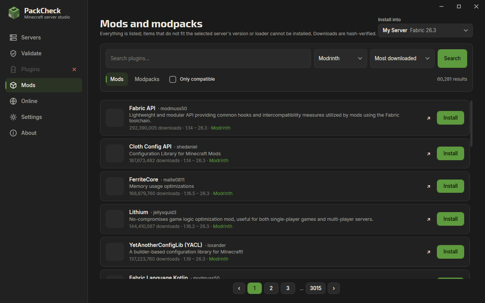

<p align="center">
  
</p>

<p align="center">
  <b>Free Minecraft server manager for Windows: create, run and validate Minecraft Java servers, and catch broken plugin and mod packs before they go live.</b>
</p>

<p align="center">
  <a href="https://github.com/X1NPAR1/PackCheck/releases/latest"></a>
  <a href="https://github.com/X1NPAR1/PackCheck/releases"></a>
  <a href="https://github.com/X1NPAR1/PackCheck/actions/workflows/ci.yml"></a>
  <a href="LICENSE"></a>
  
  
</p>

<p align="center">
  <a href="https://x1npar1.github.io/PackCheck/"><b>Website</b></a> ·
  <a href="https://github.com/X1NPAR1/PackCheck/releases/latest">Download</a> ·
  <a href="#cli">CLI</a> ·
  <a href="docs/security.md">Security model</a> ·
  <a href="CHANGELOG.md">Changelog</a>
</p>

---

PackCheck is a free, open-source Windows desktop app (WPF, .NET 10) for anyone who hosts a Minecraft Java server at home: a survival world for friends, a modded server, or a small network behind a proxy. It does two jobs:

- **Server studio.** Create a Paper, Purpur, Folia, Spigot, Vanilla, Fabric, Quilt, Forge, NeoForge, Mohist, Velocity or BungeeCord server from official sources in a few clicks, pick RAM and CPU cores, start and stop it, watch the live console and TPS, edit `server.properties`, install plugins and mods, open it to your friends over the internet, and take backups.
- **Pack validation.** Before you add or update plugins, PackCheck reads every JAR and config file and tells you what will break: missing dependencies, duplicate plugins, corrupt downloads, plugins built for a newer Minecraft version, invalid settings. Each finding comes with evidence and a suggested fix.

Static checks never execute plugin code. A real startup test is available, but you have to turn it on yourself, and it runs on a throw-away copy of the pack.

## Screenshots

| Server dashboard | Create a server |
|---|---|
|  |  |

| Pack validation | Theme and language |
|---|---|
|  |  |

| Play over the internet | Tray menu |
|---|---|
|  |  |

| Files and code editor | Mods browser |
|---|---|
|  |  |

| Startup | Settings |
|---|---|
|  |  |

## Features

**Servers**
- 18 platforms: Paper, Purpur, Folia, Leaf, Leaves, Spigot and CraftBukkit (compiled with BuildTools), Vanilla, Fabric, Quilt, Forge, NeoForge, SpongeVanilla, Mohist, Youer, Arclight, and the proxies Velocity and BungeeCord. Version lists come from each project's own API, so only versions with a real download appear.
- Downloads are hash-verified wherever the source publishes a hash; Forge, NeoForge, Quilt and BuildTools run automatically.
- The right Java (8, 17, 21 or 25) is installed automatically from Eclipse Temurin before a server starts.
- Create wizard with ready-made profiles (survival with friends, modded, creative, minigames, hardcore, low-end PC), platform cards, RAM slider (1–32 GB, warns when it leaves too little for Windows), CPU core limit, game rules (game mode, difficulty, players, view distance, PvP, whitelist, online mode, hardcore, MOTD), a free port chosen for you and a live capacity estimate.
- Change memory, CPU cores and garbage-collector flags later; see PID, threads, handles and the exact Java start command.
- Delete a server for good from its page, with two confirmations (backups are kept).
- Explicit EULA consent: nothing is accepted on your behalf.
- Live dashboard: ring gauges for TPS, CPU, RAM and ping with five health levels, players, uptime, disk and world size.
- Console with level filters and counters, search that highlights matches with next/previous, clickable player names (op, kick, ban, teleport), timestamps, copy/save, command history and Tab completion, quick actions, player list, and a crash banner that can hand the error to the assistant.
- Files tab: upload by drag and drop, multi-select, copy/cut/paste, zip/unzip, delete to the Recycle Bin, and a code editor with line numbers, syntax highlighting and a syntax check before saving.
- `server.properties` editor with every setting explained, grouped, typed and resettable.
- Every server process tree runs in a Windows Job Object; nothing keeps running after a crash or a forced stop.
- Zip backups with retention and restore.

**Plugins, mods and modpacks**
- Browse Modrinth, Hangar and CurseForge page by page, sorted by downloads or updates and filtered by category, without having to search first.
- Project detail panel with the full description, supported versions and loaders.
- Installed plugins and mods show **Update** when a newer compatible file exists; updating replaces the old jar safely.
- Items that do not match the selected server's Minecraft version or loader cannot be installed, and the reason is shown.
- Modrinth `.mrpack` modpacks are installed file by file with SHA-512 checks; CurseForge server packs are extracted safely.
- The sidebar only enables Plugins or Mods when the selected server can use them.

**Proxy networks**
- Connect Velocity or BungeeCord to backend servers; PackCheck writes `velocity.toml` / `config.yml`, a forwarding secret, and secures every backend (offline mode behind the proxy, bound to 127.0.0.1).
- Setup check for secret mismatches, unsafe backends and port clashes; start and stop the whole network in order.

**AI assistant**
- Choose a provider (Anthropic Claude, OpenAI, Google Gemini, xAI Grok, DeepSeek, Mistral, Groq, OpenRouter, Ollama, LM Studio) and pick one of its models from a list; the key is stored encrypted with Windows DPAPI.
- Answers stream in as they are written, with Markdown formatting; each server keeps its own chat history.
- It reads the console, files and validation results, and can edit configs, translate plugin message files, send commands or create several servers at once.
- Every change waits for your approval with a preview; it cannot leave the server folder and has no shell.

**Online**
- Open a server to the internet: a firewall rule (after you approve the Windows prompt) and UPnP forwarding on the router.
- Copy the public address, get A and SRV records for your own domain, optionally keep a DuckDNS name up to date.
- When the router refuses automatic forwarding, a step-by-step guide shows the exact values to enter, links to the router page and explains CGNAT, double routers and NAT loopback.
- **Test from outside** checks whether players on the internet can really reach the server.
- Carrier-grade NAT is detected and explained. Closing removes the forwarding and the firewall rule again, and PackCheck offers to close open ports when you quit.

**Validation**
- Pack structure, `server.properties` values, corrupt or unreadable JARs, oversized files.
- Reads `plugin.yml` and `paper-plugin.yml` metadata; compatibility is never guessed from file names.
- Required and optional dependencies, duplicates, `api-version` vs. server version, Java vs. Minecraft version.
- Mods: Fabric, Quilt, Forge and NeoForge metadata, missing dependencies, Minecraft version ranges, client-only mods, duplicates and mixed loaders.
- Results are `PASS`, `WARN`, `FAIL`, `SKIP` or `ERROR`. "Failed" and "could not run" are never the same thing.
- Findings grouped by severity, category or file, a file tree of affected files, search, a plugin inventory (version, API, size, SHA-256, dependencies) and "Ask the assistant" on any problem.
- Pre-flight checks before plugin changes, run history with diff, JSON (with a [schema](docs/schema/report.schema.json)) and self-contained HTML reports.

**App**
- EXE and MSI installers, per-user, no admin rights needed.
- English, Turkish, German, French and Russian, switchable instantly.
- Dark and light themes (or follow Windows); Full, Reduced or Off animations.
- Runs in the system tray with a menu that shows every server's state and starts or stops them; optionally starts with Windows.
- No telemetry.

## Updates

On every start, PackCheck asks GitHub for the latest release.

- If a newer version exists, a dialog shows its release notes. You can update now or postpone.
- You can postpone on the day the update is first announced and on the next day. **On the first launch of the third day, PackCheck installs the update by itself.**
- With **Settings → Updates → Install new releases automatically** turned on, new releases are installed at startup without asking.
- Packages are downloaded only from the repository's release assets and are rejected if their SHA-256 does not match the published `.sha256` file.
- Offline? The check is skipped silently and the app starts normally.

## Install

Download **`PackCheck-Setup-<version>.exe`** (or the `.msi`) from the [latest release](https://github.com/X1NPAR1/PackCheck/releases/latest) and run it.
It installs for your Windows user only, so no administrator rights are needed, and later updates install silently.

The app is self-contained, so .NET does not need to be installed. Windows 10 or 11 (x64) is required. The binaries are not code-signed yet, so SmartScreen may warn on the first launch.

## CLI

`packcheck` is the same validation engine without the UI. It is useful in CI.

```text
packcheck validate <folder|pack.zip> [--format text|json|html] [--output file]
                   [--mc-version 1.20.4] [--java 21] [--fail-on-warnings] [--timeout 300] [--verbose]
packcheck doctor
packcheck version
```

| Exit code | Meaning |
|---|---|
| 0 | Pass, or pass with warnings |
| 1 | Validation failed (or warnings with `--fail-on-warnings`) |
| 2 | Incomplete: a check could not run |
| 64 | Usage error |
| 70 | Internal error |

Example output:

```text
PackCheck 3.1.1 - demo-pack
  [FAIL ] PC040 Missing dependency: 'EconomyShop' requires 'ProtocolLib', which is not installed. The plugin will not enable.
           plugin.yml: depend: [Vault, ProtocolLib]
           fix: Install 'ProtocolLib' or remove 'EconomyShop'.
  [FAIL ] PC030 Duplicate plugin: 'Homes' is installed 2 times; the server loads only one of them.
Result: FAIL  (pass 2, warn 1, fail 5, skip 1, error 0)
```

### GitHub Actions

```yaml
- name: Validate server pack
  shell: pwsh
  run: |
    Invoke-WebRequest https://github.com/X1NPAR1/PackCheck/releases/latest/download/packcheck-cli-win-x64.zip -OutFile packcheck.zip
    Expand-Archive packcheck.zip -DestinationPath packcheck
    ./packcheck/packcheck.exe validate ./server --mc-version 1.20.4 --format html --output packcheck-report.html
```

## Checks

| ID | Check |
|---|---|
| PC000 | Target exists; archive is safe to extract (path traversal, zip bombs) |
| PC001 / PC002 | Pack structure, server JAR present |
| PC010 / PC011 | `server.properties` values, offline-mode warning |
| PC020 / PC021 / PC022 | Corrupt JAR, missing metadata, oversized file |
| PC030 / PC031 | Duplicate plugin names, identical files |
| PC040 / PC041 | Required and optional dependencies |
| PC050 / PC051 | `api-version` vs. server, Java vs. Minecraft |
| RT001 / RT002 | Runtime test: server start, plugin enable errors (opt-in) |

Adding a check means adding one class that implements `IAnalyzer`. See [docs/rule-authoring.md](docs/rule-authoring.md).

## FAQ

**How do I make a Minecraft server on Windows?** Install PackCheck, click **New server**, pick a profile (for example *Survival with friends*), accept the EULA and press **Create server**. PackCheck downloads the server, installs the right Java and starts it.

**How do my friends join?** On the same Wi-Fi they use the local address shown on the **Online** page. Over the internet press **Open to the internet**; if your router does not allow automatic forwarding, follow the guide on that page and use **Test from outside** to confirm.

**Which platform should I pick?** Paper for plugins, Fabric or NeoForge for mods, Velocity to connect several servers. Each platform card explains itself.

**Why does my plugin or mod not load?** Run **Validate** on the server: it lists missing dependencies, wrong Minecraft versions, duplicates and corrupt jars with the fix.

**Is it free?** Yes, MIT licensed, no account, no telemetry.

## Documentation

- [Architecture](docs/architecture.md) · [Design system](docs/design-system.md) · [Localization](docs/localization.md)
- [Testing](docs/testing.md) (unit, network, real-server and UI tests) · [Performance](docs/performance.md) (measured)
- [Security model](docs/security.md) · [Writing a check](docs/rule-authoring.md)
- Research: [ServerCreator audit](docs/research/servercreator-audit.md), [other tools](docs/research/competitors.md), [common problems](docs/research/user-problems.md), [Minecraft brand rules](docs/research/minecraft-brand.md)

## Build from source

```powershell
dotnet build PackCheck.sln
dotnet test tests/PackCheck.Tests
dotnet test tests/PackCheck.UiTests   # UI tests, needs a desktop session
dotnet run --project src/PackCheck.App
```

Requires the .NET 10 SDK on Windows.

| Project | Responsibility |
|---|---|
| `PackCheck.Core` | Result model, versions, hashing, exit codes |
| `PackCheck.Validation` | Analyzers, safe zip extraction, metadata parsing |
| `PackCheck.Reporting` | JSON / HTML reports, run diff |
| `PackCheck.Servers` | Downloads, Java runtimes, process + Job Object, backups, runtime test |
| `PackCheck.Providers` | Modrinth, Hangar and CurseForge clients (timeouts, cache, failures as values) |
| `PackCheck.Updater` | GitHub release check, grace-period policy, verified install |
| `PackCheck.App` | WPF UI |
| `PackCheck.Cli` | Headless CLI |
| `PackCheck.UpdateHelper` | Replaces files after the app exits during an update |

## Known limitations

- Windows only.
- Pufferfish is not offered because its build server was not reachable; Magma, Glowstone and Waterfall are no longer maintained.
- CurseForge needs your own API key (Settings), because CurseForge does not allow anonymous access.
- Fabric's server launcher has no published checksum, so it is verified only by HTTPS.
- The runtime test isolates files, ports and memory, but plugin code still runs with your user account's rights. Read [docs/security.md](docs/security.md) before you use it on plugins you don't trust.
- Version checks rely on what plugins declare. A plugin that declares nothing gets a warning, not a guess.

## License

[MIT](LICENSE). Third-party components are listed in [THIRD_PARTY.md](THIRD_PARTY.md).

*Not an official Minecraft product. Not approved by or associated with Mojang or Microsoft.*
